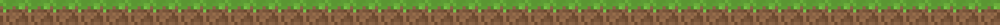
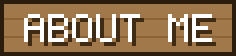
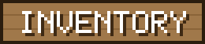
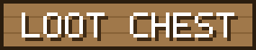
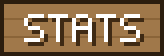
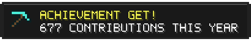
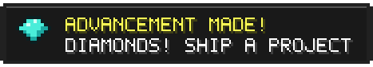

<div align="center">








</div>

```yaml
player:      housseinelyatim-exe
spawn_point: ENSI, Tunisia 🇹🇳
guild:       IEEE ENSI Student Branch
biome:       web apps, AI and data, edge devices
quest:       build things that are actually useful
```

<div align="center">


<br/><br/>




</div>

| | Item | Lore |
|:-:|---|---|
| 🧪 | [**hackcure-datasets**](https://github.com/housseinelyatim-exe/hackcure-datasets) | Medical Q&A dataset (EN/FR/Darija) relabeled for emergency triage |
| 🗺️ | [**city-brain-notebooks**](https://github.com/housseinelyatim-exe/city-brain-notebooks) | One notebook per public dataset behind the City Brain |
| 🌦️ | [**intro-dev-weather-starter**](https://github.com/housseinelyatim-exe/intro-dev-weather-starter) | Weather dashboard starter for the Software Dev 101 lab (IEEE ENSI CS SBC) |
| 🛒 | [**QuickCart-E-Commerce**](https://github.com/housseinelyatim-exe/QuickCart-E-Commerce) | JavaScript e-commerce project |
| 📅 | [**ProjetC-SystemeDeGestionDesReservations**](https://github.com/housseinelyatim-exe/ProjetC-SystemeDeGestionDesReservations) | Reservation management system in C |
| 👓 | [**optima-optique**](https://github.com/housseinelyatim-exe/optima-optique) | TypeScript project |

<div align="center">


<br/><br/>




<br/><br/>


<sub>⛏️ Not affiliated with Mojang or Microsoft. All block art is hand-drawn SVG in this repo (<code>scripts/gen.py</code>).</sub>

</div>
